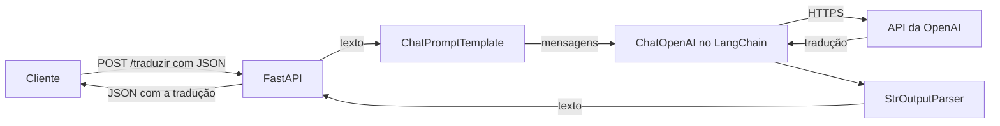

# DR3 TP2 | Parte 2, Questão 2: tradução inglês-francês com OpenAI via LangChain (FastAPI)

API em FastAPI que recebe um texto em inglês e devolve a tradução para o francês usando um modelo da OpenAI por meio do LangChain (`ChatPromptTemplate | ChatOpenAI | StrOutputParser`).

## Estrutura

```
├── app/
│   ├── main.py       # API FastAPI, tratamento de erros da OpenAI e cadeia reaproveitada
│   ├── schemas.py    # modelos Pydantic de entrada e saída
│   └── service.py    # prompt de tradução e montagem da cadeia
├── tests/test_api.py
├── requirements.txt
└── README.md
```

## Arquitetura



Gestão das chamadas: a cadeia é criada uma vez e reaproveitada, o que mantém a conexão HTTP aberta entre requisições; a rota é assíncrona (`ainvoke`), então várias requisições esperam a OpenAI ao mesmo tempo; há `timeout` de 30 segundos e 2 novas tentativas; os erros da OpenAI viram códigos HTTP claros (429 limite de uso, 504 tempo esgotado, 502 falha de conexão ou erro da API, 503 chave não configurada).

## Requisitos

- Python 3.12
- Uma chave da API da OpenAI.

## Instalação

```bash
python -m venv .venv
# Windows
.venv\Scripts\activate
# Linux/macOS
source .venv/bin/activate

pip install -r requirements.txt
```

## Configuração

A chave é lida da variável de ambiente `OPENAI_API_KEY` (não grave a chave no código nem no repositório). O modelo pode ser trocado com `OPENAI_MODEL` (padrão: `gpt-6-luna`).

```bash
# Linux/macOS
export OPENAI_API_KEY="sua-chave"
# Windows (PowerShell)
$env:OPENAI_API_KEY = "sua-chave"
```

## Execução

```bash
uvicorn app.main:app --reload
```

- API: http://127.0.0.1:8000
- Documentação interativa (Swagger): http://127.0.0.1:8000/docs

## Uso

`POST /traduzir`

```bash
curl -X POST http://127.0.0.1:8000/traduzir -H "Content-Type: application/json" -d '{"texto": "Good morning! How are you today?"}'
```

Resposta:

```json
{
  "texto_original": "Good morning! How are you today?",
  "traducao": "...",
  "modelo": "gpt-6-luna",
  "tempo_ms": 800.1
}
```

`GET /health` informa o modelo configurado e se a chave está definida.

## Testes

```bash
pytest
```

Os testes não usam a internet nem a chave: a cadeia é montada com um chat model falso do LangChain, e os erros da OpenAI são simulados.
